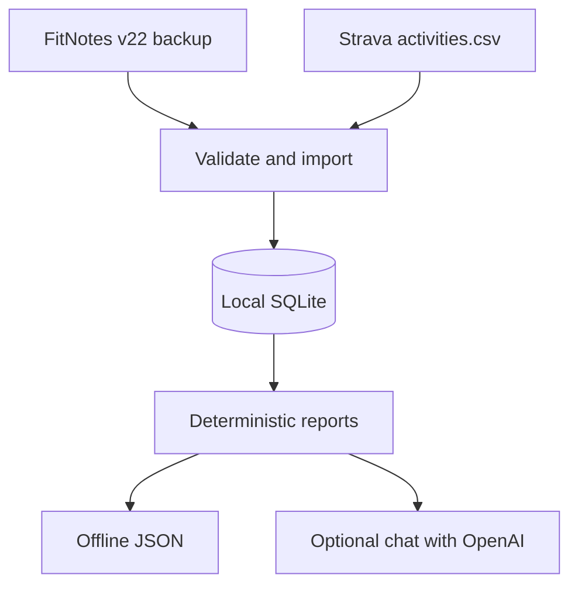
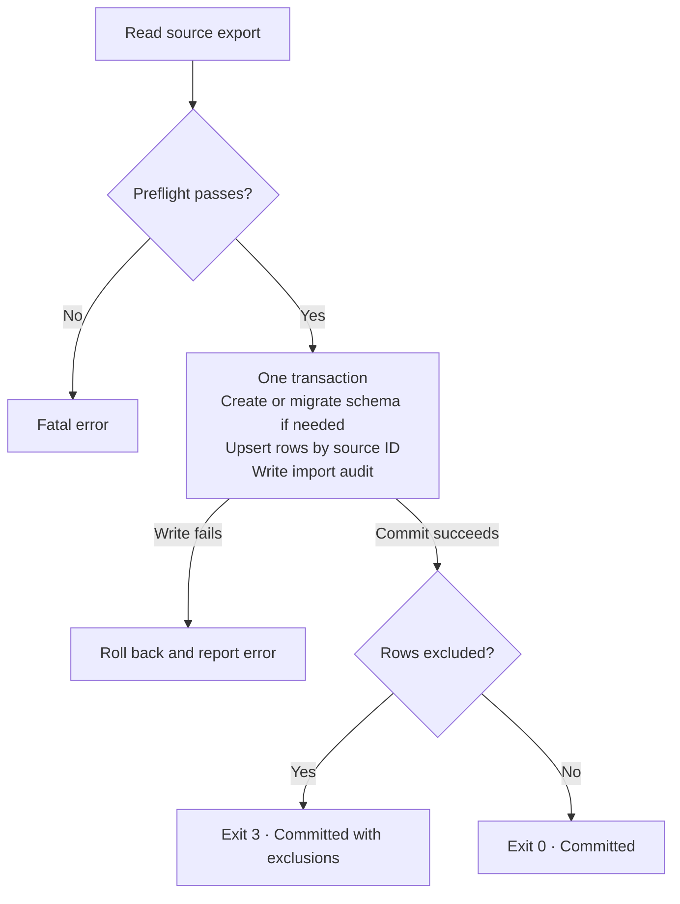
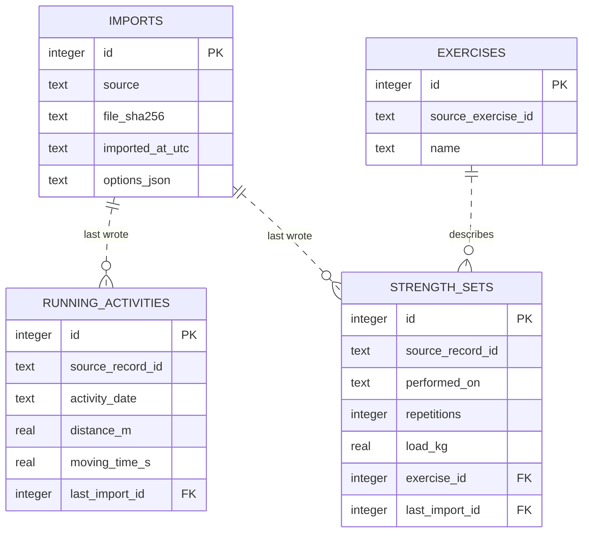
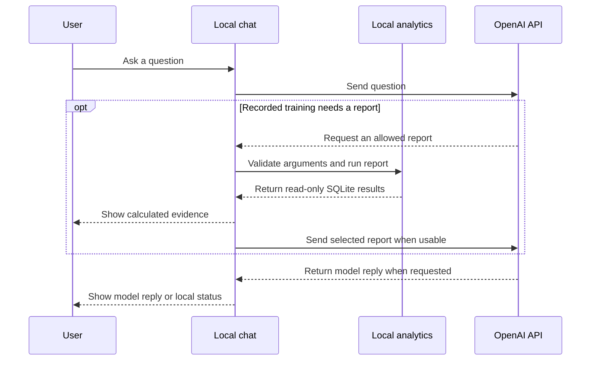
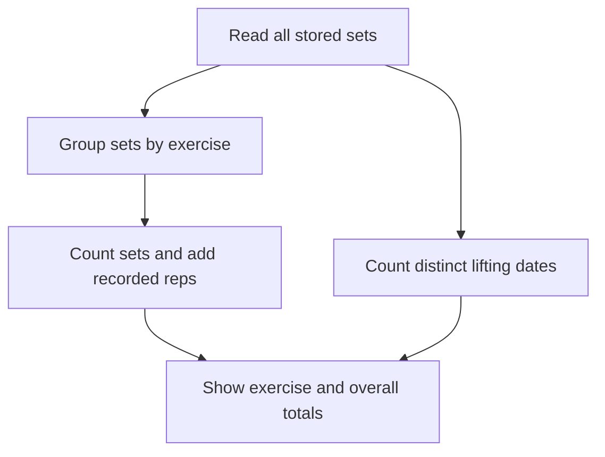
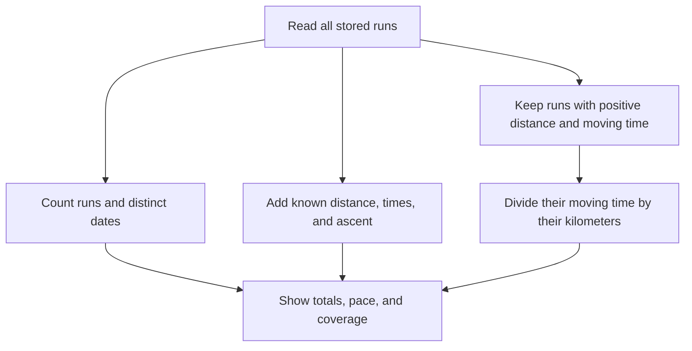
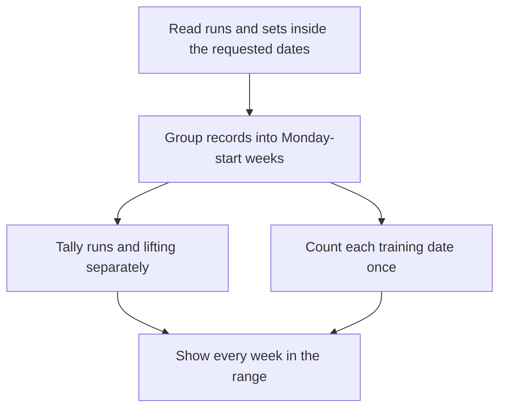
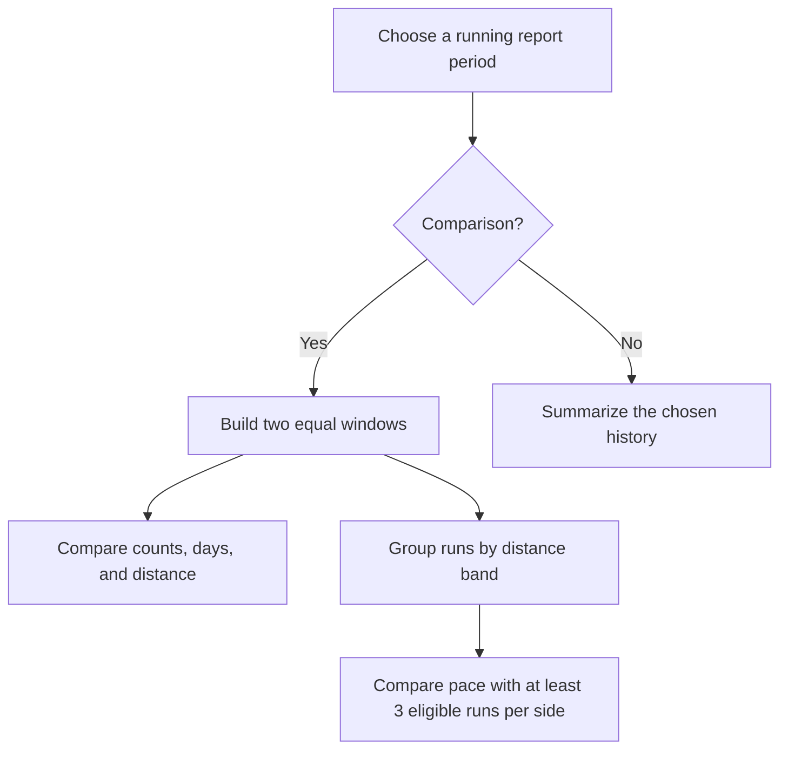
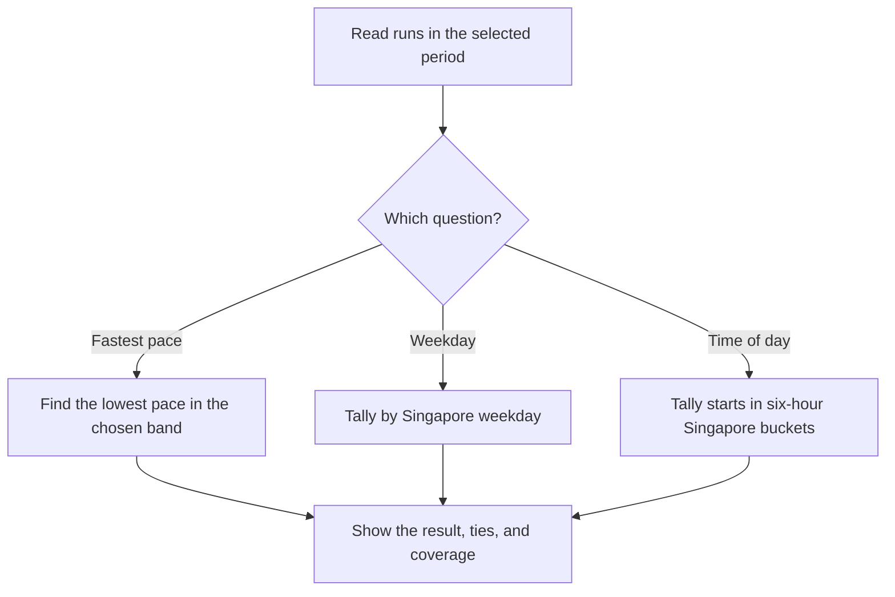
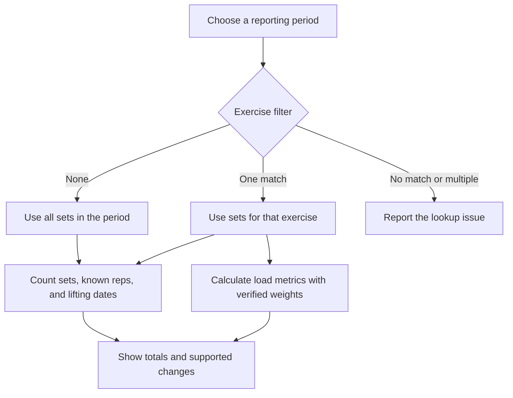

# Unified Fitness

Turn FitNotes strength records and Strava running exports into local SQLite
reports. Use the command line for offline analytics or enable the optional
OpenAI console for questions about recorded training.



## Setup

Use Python 3.11 or newer. From the repository root in PowerShell:

```powershell
py -m venv .venv
.\.venv\Scripts\python.exe -m pip install -e .
.\.venv\Scripts\unified-fitness.exe --help
```

Choose the install target that fits what you want to do:

| Install target | What it includes |
| --- | --- |
| `.` | Imports and offline reports |
| `".[ai]"` | The app and the OpenAI SDK for optional chat |
| `".[dev]"` | The app and pytest for running tests |
| `".[ai,dev]"` | The app, chat support, and pytest |

If you already installed with `".[ai]"`, you can use the CLI and optional
chat with that environment. Add the `dev` extra if you want to run the tests.

On macOS/Linux, use `python3 -m venv .venv`, `.venv/bin/python` and
`.venv/bin/unified-fitness`. Windows installs `tzdata` for Singapore reporting
dates. Imports and offline reports work without the AI extra or API credentials.

## Quick start

Place your exports under `data/`. Substitute your filenames below and run either
or both imports. Use `--assume-performed` after confirming the FitNotes export
contains performed sets. The commands share `data/unified-fitness.sqlite3`.

```powershell
.\.venv\Scripts\unified-fitness.exe import-fitnotes data/your-backup.fitnotes --assume-performed
.\.venv\Scripts\unified-fitness.exe import-strava data/strava-export/activities.csv
.\.venv\Scripts\unified-fitness.exe weekly-summary --from 2024-01-01 --to 2024-01-28
```

Use dates covered by your exports. Strava imports can return exit code `3`
when they commit runs and exclude other sports. See the [user guide](docs/user-guide.md)
for import outcomes and report examples.

| I want to… | Command |
| --- | --- |
| See lifetime set, rep, and training-day totals | `summary` |
| See lifetime run totals and moving pace | `running-summary` |
| See running and lifting together by week | `weekly-summary --from YYYY-MM-DD --to YYYY-MM-DD` |
| Compare periods or browse running history | `running-trends` |
| Find my fastest pace or common running times | `running-records` |
| Compare strength activity or filter by exercise | `strength-activity` |
| Ask a question in natural language | `chat` after [AI setup](docs/user-guide.md#use-the-optional-ai-console) |

## How it works

### What happens during an import

Both importers validate the export, then save accepted records and their audit
entry together. Reimporting the same source IDs updates changed records and
keeps unchanged records intact.



### What SQLite stores

Each lift set links to an exercise. Each run or set links to the import that
last wrote it. The diagram shows the main columns and relationships.



### What happens when you use chat

Offline reports read SQLite directly. Optional chat sends your question to
OpenAI and can send one locally calculated report for a question about
recorded training. It shows the local evidence alongside the model reply.



## How reports work

Every report reads your local SQLite records and applies fixed rules. Coverage
counts tell you how many stored records contributed to a calculation.

### 1. Strength summary · `summary`

Imagine a notebook with one line for every set. Sort the lines by exercise,
count them, and add the reps written on them. Count each lifting date once.
Three squat sets and two bench sets on Monday make five sets and one training
day. A set with missing reps still counts as a set.

<details>
<summary>Show strength summary flowchart</summary>



</details>

### 2. Running summary · `running-summary`

Count the runs, circle each running date once, and add up the measurements you
have. For pace, use runs with positive distance and moving time. Add their
moving times and divide by their combined distance. A 5 km run in 25 minutes
and a 10 km run in 60 minutes give 85 minutes over 15 km, or **5:40/km**. A run
with missing moving time still counts as a run and can contribute its distance
to the distance total.

<details>
<summary>Show running summary flowchart</summary>



</details>

### 3. Weekly training · `weekly-summary`

Put each run and lifting set into its Monday-start week. Tally running and
lifting separately, then count the dates with either activity. A run and a
lift on Tuesday count as **one combined training day**. Every week touched by
the range appears, even if it is empty. If the range starts on Wednesday,
the first week only includes records from Wednesday onward.

<details>
<summary>Show weekly training flowchart</summary>



</details>

### 4. Running trends · `running-trends`

Put two equal stretches of the calendar side by side. By default, compare the
last four completed Singapore weeks with the four weeks before them. Compare
run counts, running days, and distance when there is enough data. For pace,
group runs into under 5 km, 5 to under 10 km, and 10 km or more. Each band
needs **at least three runs with usable pace on each side**. Fewer seconds per
kilometer means faster recorded pace, and different bands can move in
different directions.

To browse history, choose a date range for weekly buckets, a calendar year
for monthly buckets, or the yearly view for up to 12 calendar years. All-time
totals include older stored history.

<details>
<summary>Show running trends flowchart</summary>



</details>

### 5. Running records and patterns · `running-records`

| Question | How the report answers |
| --- | --- |
| What was my fastest pace? | In the chosen distance band, calculate each eligible run's whole-run moving pace. Pick the lowest seconds per kilometer and count ties. |
| Which weekday do I run most often? | Tally runs by the weekday of their Singapore reporting date. Show every weekday tied for the most runs. |
| What time of day do I usually run? | Convert usable UTC starts to Singapore time and tally them in four six-hour buckets. Show every bucket tied for the most runs. |

The fastest-pace result covers a whole run. An individual fast kilometer
inside that run has no separate entry.

<details>
<summary>Show running records flowchart</summary>



</details>

### 6. Strength activity · `strength-activity`

Take the strength notebook and filter it by dates and, optionally, by exercise.
Count sets, add known reps, and count lifting dates. If the name is missing
from your records or matches more than one stored exercise, the report says
so. A comparison needs rep counts for every set on both sides to show a rep
change.

For one named exercise with verified external weights, the report finds the
heaviest eligible set, adds weight × reps for volume, and estimates a one-rep
max from sets of 2–10 reps. A set of 20 kg for five reps adds 100 kg·reps.
The one-rep max is approximate because the records do not capture how hard the
set was. Current FitNotes imports leave normalized weights unknown, so these
load metrics are unavailable for those imports.

<details>
<summary>Show strength activity flowchart</summary>



</details>

## Where to look next

| Document | What it covers |
| --- | --- |
| [User guide](docs/user-guide.md) | Imports, command examples, reporting periods, coverage, and chat setup |
| [Architecture and data model](planning/architecture.md) | Import lifecycle, SQLite relationships, and the local-to-remote boundary |
| [Implementation plan](planning/implementation-plan.md) | Milestones, verification, and remaining work |
| [Engineering decisions](planning/decisions.md) | Design choices and open questions |
| [FitNotes discovery](planning/fitnotes-discovery.md) and [Strava discovery](planning/strava-discovery.md) | Validated source layouts and mapping limits |

Keep personal exports, databases, and reports in ignored `data/`. Keep API
credentials in the environment or an ignored local `.env` file.

Run the offline tests with `.\.venv\Scripts\python.exe -m pytest`.
