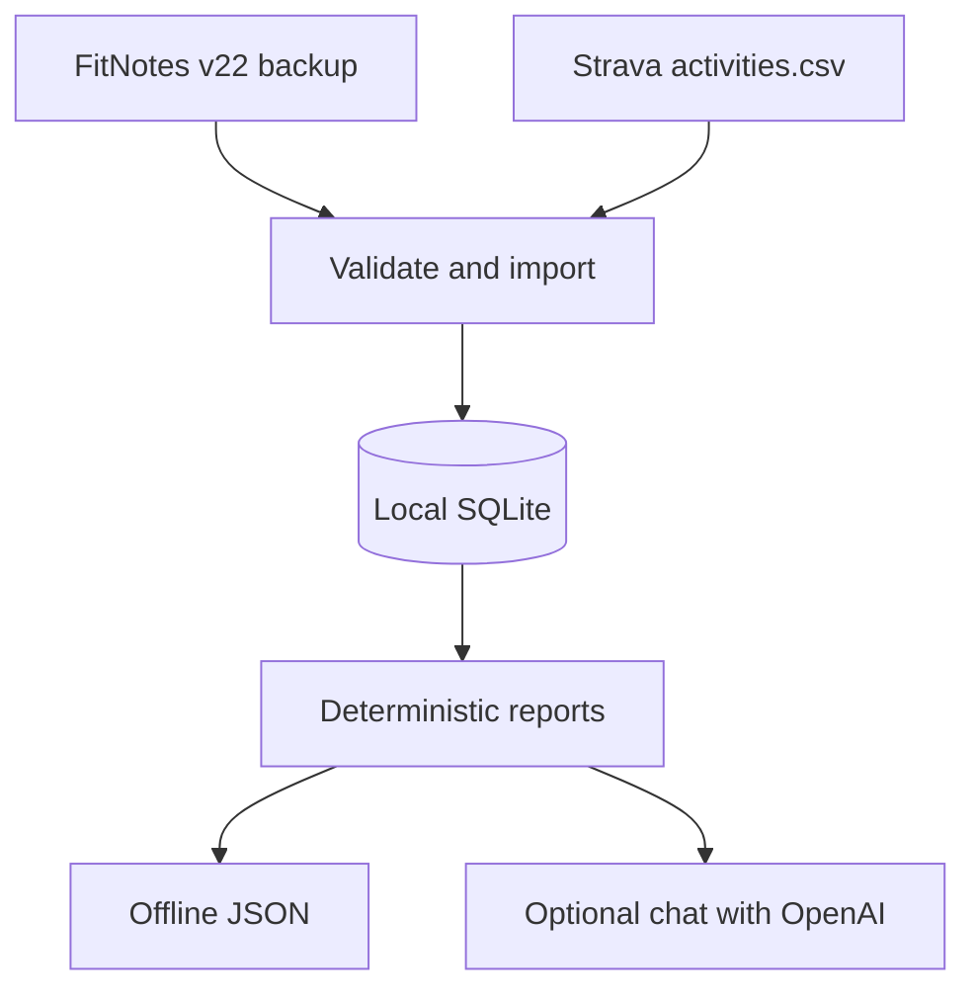
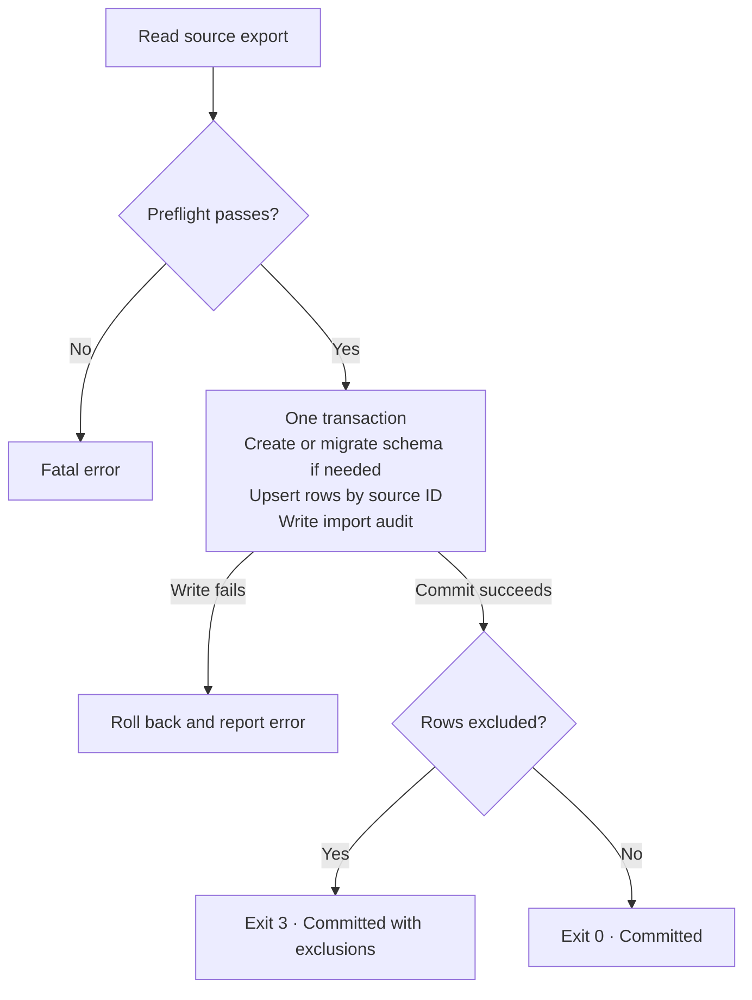
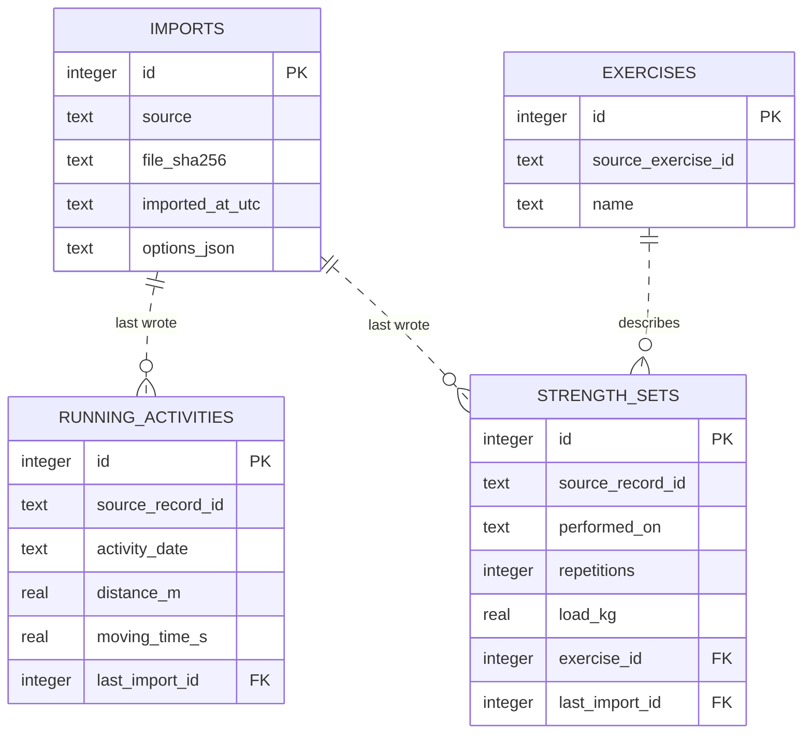
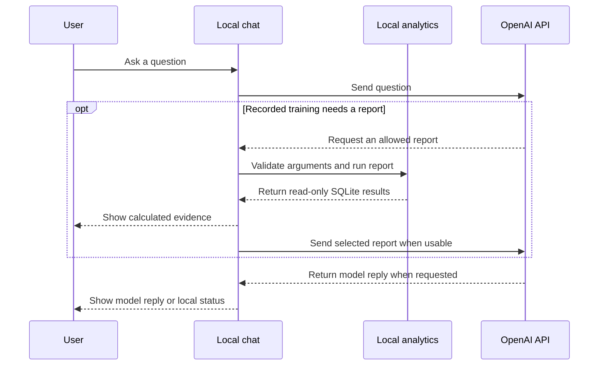

# Unified Fitness

Turn FitNotes strength records and Strava running exports into local SQLite
reports. Use the command line for offline analytics or enable the optional
OpenAI console for questions about recorded training.



## Setup

Use Python 3.11 or newer. From the repository root in PowerShell:

```powershell
py -m venv .venv
.\.venv\Scripts\python.exe -m pip install -e ".[dev]"
.\.venv\Scripts\unified-fitness.exe --help
```

On macOS/Linux, use `python3 -m venv .venv`, `.venv/bin/python` and
`.venv/bin/unified-fitness`. Windows installs `tzdata` for Singapore reporting
dates. Imports and offline reports work without the AI extra or API credentials.

## Quick start

Place your exports under `data/`. Substitute your filenames below and run either
or both imports. Use `--assume-performed` after confirming the FitNotes export
contains performed sets. The commands share `data/unified-fitness.sqlite3`.

```powershell
.\.venv\Scripts\unified-fitness.exe import-fitnotes data/your-backup.fitnotes --assume-performed
.\.venv\Scripts\unified-fitness.exe import-strava data/strava-export/activities.csv
.\.venv\Scripts\unified-fitness.exe weekly-summary --from 2024-01-01 --to 2024-01-28
```

Use dates covered by your exports. Strava imports can return exit code `3`
when they commit runs and exclude other sports. See the [user guide](docs/user-guide.md)
for import outcomes and report examples.

| I want to… | Command |
| --- | --- |
| See lifetime set, rep, and training-day totals | `summary` |
| See lifetime run totals and moving pace | `running-summary` |
| See running and lifting together by week | `weekly-summary --from YYYY-MM-DD --to YYYY-MM-DD` |
| Compare periods or browse running history | `running-trends` |
| Find my fastest pace or common running times | `running-records` |
| Compare strength activity or filter by exercise | `strength-activity` |
| Ask a question in natural language | `chat` after [AI setup](docs/user-guide.md#use-the-optional-ai-console) |

## How it works

### What happens during an import

Both importers validate the export, then save accepted records and their audit
entry together. Reimporting the same source IDs updates changed records and
keeps unchanged records intact.



### What SQLite stores

Each lift set links to an exercise. Each run or set links to the import that
last wrote it. The diagram shows the main columns and relationships.



### What happens when you use chat

Offline reports read SQLite directly. Optional chat sends your question to
OpenAI and can send one locally calculated report for a question about
recorded training. It shows the local evidence alongside the model reply.



## Where to look next

| Document | What it covers |
| --- | --- |
| [User guide](docs/user-guide.md) | Imports, command examples, reporting periods, coverage, and chat setup |
| [Architecture and data model](planning/architecture.md) | Import lifecycle, SQLite relationships, and the local-to-remote boundary |
| [Implementation plan](planning/implementation-plan.md) | Milestones, verification, and remaining work |
| [Engineering decisions](planning/decisions.md) | Design choices and open questions |
| [FitNotes discovery](planning/fitnotes-discovery.md) and [Strava discovery](planning/strava-discovery.md) | Validated source layouts and mapping limits |

Keep personal exports, databases, and reports in ignored `data/`. Keep API
credentials in the environment or an ignored local `.env` file.

Run the offline tests with `.\.venv\Scripts\python.exe -m pytest`.
