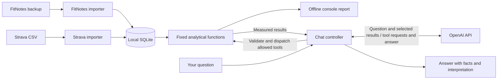
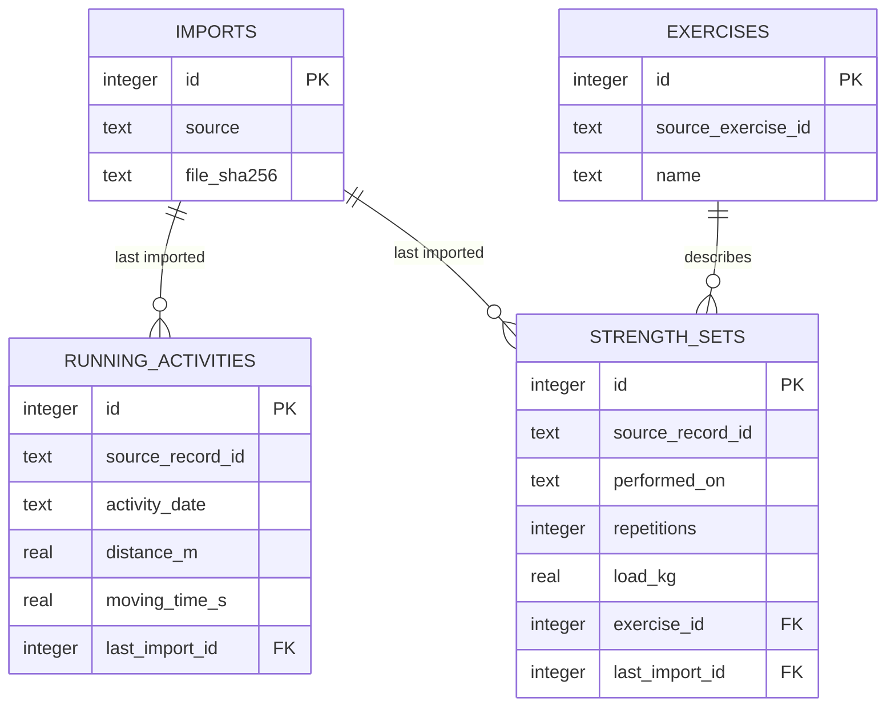

# Architecture

Status: FitNotes discovery recommendations accepted on 2026-11-09. No application
code or DDL implemented; unverified source mappings remain validation gates.

The first backup has now been inspected: see [FitNotes discovery](fitnotes-discovery.md).
The accepted design keeps four tables, preserves source flags/type codes, and starts
with a reps-focused report. Weight encodings and ID stability across backups remain
unverified; the target model below does not imply a fully validated source contract.

## Scope and boundaries

One user, one account per source, one local SQLite database, one synchronous Python
process. Keep the requested Python/SQLite/pytest stack. Use standard-library
`argparse`, `sqlite3`, `csv`, `datetime`, and small dataclasses where useful.
Avoid an ORM, web server, dataframe dependency, plugin framework, and agent framework.

Planned modules inside `src/unified_fitness/` (create only with working features):

| Module | Responsibility |
| --- | --- |
| `cli.py` | Parse commands, display reports, run the interactive console |
| `ingestion/fitnotes.py`, `ingestion/strava.py` | Validate formats and map source records |
| `db.py` | Connection setup, versioned schema, transactions, parameterized writes |
| `analytics.py` | Fixed read-only queries and deterministic metric calculations |
| `llm.py` | OpenAI calls, tool schemas, allowlisted dispatch, bounded chat loop |

Flow: local file -> source adapter -> validated records -> SQLite -> analytical
functions -> CLI report or tool result -> optional AI explanation.

The chat controller mediates every tool request. OpenAI has no direct database access.

Adapters expose the same small callable contract: `import_file(path, connection,
options) -> ImportReport`. Report inserted, updated, unchanged, rejected, and
unsupported counts plus bounded diagnostics (row/source ID and reason, not full
personal records). A shared report type is sufficient; no abstract base class or
dynamic plugin registry. Source adapters own mapping; persistence owns writes.

## Target relational model

Internal primary keys are integers; source identifiers are TEXT to preserve their
exact representation. `source` is a stable namespace (`fitnotes` or `strava`).
Source fields below are canonical requirements, not claims about export columns.

| Table | Planned columns and constraints |
| --- | --- |
| `imports` | `id` PK, `source`, `file_sha256`, `imported_at_utc`, `adapter_version`, `options_json`, outcome counts; one row per committed attempt |
| `running_activities` | `id` PK, `source`, `source_record_id`, `activity_date`, nullable `started_at_raw`, `started_at_utc`, `timezone_name`, `distance_m`, `moving_time_s`, `elapsed_time_s`, `elevation_gain_m`; `last_import_id` FK; UNIQUE (`source`, `source_record_id`) |
| `exercises` | `id` PK, `source`, `source_exercise_id`, `name`; nullable INTEGER `source_type_id`, `source_weight_unit_id`; UNIQUE (`source`, `source_exercise_id`) |
| `strength_sets` | `id` PK, `source`, `source_record_id`, `exercise_id` FK, `performed_on`, nullable `repetitions`, `load_kg`, `source_load`, `source_load_unit`, `load_kind`, `set_order`; nullable INTEGER `source_unit_code`, `source_is_complete`, `source_is_pending_update`; `last_import_id` FK; UNIQUE (`source`, `source_record_id`) |

For the first FitNotes slice, import only exercises referenced by accepted sets.
Preserve `metric_weight` in `source_load` and retain the raw type/unit/flag codes.
Leave `source_load_unit`, `load_kg`, `load_kind`, and `set_order` NULL until their
meaning is established. Store source schema version, relevant settings, and the
explicit completion policy in the existing import `options_json`; no extra table.

### First importer contract

Implement only `imports`, `exercises`, and `strength_sets` now; add the running
table with Strava. Support the inspected SQLite `user_version=22` and validate
required tables/columns and actual stored values; do not copy all source tables.
Source and destination must be different files, including aliases/hard links.
Reject an incompatible source or destination schema before changing stored data.

Initially accept valid type-code `0` set records with zero distance/duration.
Other types or nonzero distance/duration are explicitly unsupported, not silently
truncated. Preserve finite nonnegative raw load without conversion, including
nonzero values; normalization means canonical source-ID text, valid ISO calendar
dates, and nonnegative integer reps. Unverified physical units remain NULL with a
clear warning. This scope does not validate the meaning of other exercise types.

Require an explicit import option such as `--assume-performed` to assert the file
contains performed sets, and record it in import metadata. The user has already
confirmed this for the inspected backup; no new confirmation is needed for that
file. Do not hardcode its filename, contents, or IDs into the importer.

Implement same-ID upserts and test them on synthetic snapshots under a stable-ID
assumption. That verifies our code, not FitNotes behavior across edits/reorders or
restores. Keep the latter limitation explicit until controlled source comparisons
are available; it need not block same-file idempotence or reps-only reporting.

Import outcome counts refer to source set rows, not exercise definitions:
inserted + updated + unchanged + rejected + unsupported = rows examined.
Warnings may overlap these categories. A repeated identical import leaves exercise
and set rows, including their last-change provenance, unchanged; it may append
one committed `imports` audit row. No deletion reconciliation or file-hash skipping.

Diagram shows selected columns. Each exercise can have many sets; each record points
to the import that last inserted or changed it. This is provenance, not full revision
history. Create tables only when their source milestone needs them.

Foreign keys enabled on every connection. Required identifiers and calendar dates
are NOT NULL. Validate finite, nonnegative distance/duration/load values and integer
repetitions; encode stable rules with CHECK constraints once source semantics are
confirmed. Unknown is NULL, never a fabricated zero. Start with date and exercise/date
indexes only where the first reports need them. Use `PRAGMA user_version` and explicit
schema changes; do not silently rebuild an existing database on version mismatch.

No universal activity table or strength session table initially. Sets retain their
source IDs, exercise identity, and date; this supports progression and training-day
counts without guessing session boundaries. If FitNotes exposes reliable session
IDs needed for a question, revisit the model after inspection. Report training days
as days, not workout sessions. Cross-source frequency uses distinct dates (a day
with both a run and lifting counts once).

## Ingestion, identity, and normalization

- Open FitNotes read-only. Check the SQLite header, integrity, `sqlite_master`,
  table/column metadata, keys, joins, schema version, unit settings, and date formats
  before defining mappings. No source table names or IDs have been assumed.
- Inspect Strava's actual CSV headers, including duplicate names, delimiters,
  encoding, sport values, identifiers, date conventions, and unit representations.
  Support validated running categories only; count excluded sports. Let the user
  extract the official archive; ZIP handling and original activity parsing are deferred.
- Prefer stable source keys for repeatable imports. Never deduplicate sets by
  exercise/date/weight/reps: identical sets can be legitimate. If stable IDs are
  absent, stop and agree on a tested identity policy before implementing that source.
  FitNotes `training_log._id` identifies sets in this backup; test ID stability
  through controlled edits/reordering before promising cross-backup updates.
- Include the inspected backup's user-confirmed performed sets regardless of
  `is_complete` or `is_pending_update`, preserving both flags and recording the
  policy. Do not generalize that confirmation to future backups or infer historical
  completion from the current app setting. Unsupported types/metrics are counted.
- Same IDs and payloads are unchanged; changed payloads update existing rows. A file
  hash records provenance, not record identity, and does not automatically skip an
  import (adapter fixes may need reprocessing). No deletion when an ID disappears.
  Without reliable source modification times, the most recently imported values
  win, even from an older export; report updates and document this limitation.
- Preflight format errors cause no writes. Reject malformed required fields or
  ambiguous identities with reasons. Distinguish an absent optional column from an
  explicitly empty value: absent columns preserve existing values on update (NULL
  on insert); explicit empties clear a value only if the validated source contract
  defines them as missing. A malformed optional value may become NULL with a warning
  on insert; on update, reject that record and preserve its existing values rather
  than silently erase valid history. Include warnings in the import report.
  Commit all accepted records and the import report in one transaction; unexpected
  errors roll back the entire attempt. Failed attempts print diagnostics, not a
  misleading successful audit row. Conflicting duplicate IDs in one file fail preflight.
- Normalize distance to meters, time to seconds, load to kilograms. Preserve raw
  load/unit and timestamp evidence where needed for ambiguous semantics. Do not infer
  units from value magnitude. Validate per-exercise unit overrides, completion flags,
  bodyweight/assisted loads, and non-strength FitNotes records before mapping them.
  Unsupported records must be counted, not silently coerced into strength sets.
- Preserve date-only FitNotes records as dates. Store UTC only when the source has an
  offset or an explicitly confirmed timezone mapping; retain raw timestamp text.
  Never fabricate midnight or label naive times UTC. Reject unresolved calendar-date
  ambiguity. Use the confirmed reporting timezone (`Asia/Singapore`) and record
  assumptions in import options; historical travel/DST semantics need validation.
  `activity_date` is the date in that reporting timezone when the instant is known;
  date-only records retain their recorded date. Keep the reporting timezone fixed
  per database, checking it against committed import options before subsequent
  imports. Reject a changed setting until an explicit rebuild/reimport is performed;
  do not silently mix dates calculated under different timezone policies.

## Analytics and AI boundary

The first FitNotes report provides per-exercise set/repetition totals and recorded
training days. Add running summaries with Strava; defer load-based progression and
volume until units and load semantics are validated. Date ranges use inclusive ISO
calendar dates; weeks start Monday (confirmed). Return range, units, observed source
date ranges, sample counts, and counts
of stored records missing/excluded from each calculation. Import-level rejection
totals are separate diagnostics: they cannot reliably be assigned to a requested
date range, especially when rejected dates are invalid. Observed date ranges do
not establish complete coverage; missing history is not proof of inactivity.

Pace = summed valid moving seconds / summed corresponding distance in kilometers;
exclude zero distances and never silently substitute elapsed time. Show duration
coverage and label this aggregate pace, not an average of individual paces.
Strength progression starts with observed load/reps by exercise and comparable load
kind; volume is sum(load_kg * reps) only for records with known compatible external
loads. Do not interpret unknown load as bodyweight or mix assistance with lifted load.
Estimated 1RM and causal conclusions are deferred.

The proposed OpenAI Responses API integration uses strict JSON function schemas and
an allowlist of analytical functions. The application validates dates, bounds, and
exercise IDs and runs fixed parameterized queries over a read-only connection.
There is no SQL, arbitrary file, shell, or write tool. Strict schemas constrain
arguments; they do not establish correctness of answers. See the official
[function-calling documentation](https://developers.openai.com/api/docs/guides/function-calling).

Bound tool rounds, result sizes, timeouts, and retries. Return clear errors for
unsupported questions or insufficient data. Require tool evidence for numeric
claims and separate measured facts from interpretations and optional suggestions.
Treat exercise names and other source strings as data, never instructions.

Send questions and necessary aggregates only. Do not upload originals, GPS routes,
or free-text workout notes. Disclose remote processing when chat starts. Use
`store=false` where supported, without promising zero provider retention; verify
provider data handling when implementing chat. Do not persist chats by default.
Tests use fake API responses; live API calls are explicit and optional.
