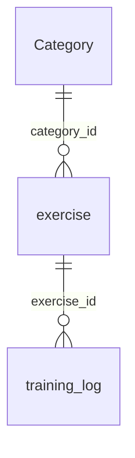

# FitNotes discovery

Inspected 2026-11-09. Discovery only: no importer, destination database, or fixtures
created. The user accepted the recommendations below on 2026-11-09. Acceptance
sets the implementation scope; it does not resolve the remaining source unknowns.

## Scope and verification

- Found one `.fitnotes` backup directly under `data/` (112 KiB). It has the SQLite
  file header, UTF-8 encoding, and `PRAGMA user_version = 22`. This is a database
  schema version, not a confirmed FitNotes app version.
- Opened with Python `sqlite3.connect(..., uri=True)` using `mode=ro`, then
  `PRAGMA query_only=ON`. Inspected `sqlite_master`, `table_info`, `foreign_key_list`,
  aggregates, and a small sample with names, IDs, and dates omitted from output.
- `integrity_check` returned `ok`. SHA-256 matched before and after inspection;
  no journal/WAL/SHM sidecars were created. The backup remains ignored by Git.
- All 24 schema objects are tables: 23 non-internal tables plus `sqlite_sequence`.
  There are no declared foreign keys, explicit indexes, views, or triggers.
  Consequently, an empty `foreign_key_check` does not prove relationship integrity;
  explicit joins found no orphan sets or orphan exercise/category references.
- `py` now runs Python 3.14.10 and SQLite 3.50.4. The `python` command remains an
  unusable Windows alias; `py` emits a path-location warning but these queries succeed.
  No packages were installed. This does not verify editable package installation.

## Table inventory

| Tables | Rows / role |
| --- | --- |
| `training_log`, `exercise`, `Category` | 24 set records, 97 exercise definitions, 8 categories; core import data |
| `settings`, `android_metadata` | One row each; app preferences and locale, not workout history |
| `WorkoutTime` | Empty; has workout date and start/end text fields, no set linkage |
| `Routine`, `RoutineSection`, `RoutineSectionExercise`, `RoutineSectionExerciseSet` | All empty; planned workout templates, not performed history |
| `WorkoutGroup`, `WorkoutGroupExercise` | Both empty; grouping metadata, not evidence of workout sessions |
| `Comment`, `WorkoutComment` | Both empty; free text should remain out of MVP import |
| `BodyWeight`, `MeasurementRecord`, `Measurement`, `MeasurementUnit` | First two empty; 15 measurement definitions and 6 unit definitions; outside MVP scope |
| `Barbell`, `Plate` | 2 and 23 equipment/calculator configuration rows; not performed loads |
| `Goal`, `ExerciseGraphFavourite`, `RepMaxGridFavourite` | All empty; targets/display preferences, outside MVP scope |

The populated relationships are logical joins, not enforced source constraints:

Other inferred references follow column names: routine -> section -> exercise ->
template set; `training_log.routine_section_exercise_set_id` references a template
set when present (all are sentinel `0` here); workout-group membership links to
groups and exercises; measurement records link to measurement definitions and units.
Empty tables cannot validate these relationships or their enum meanings.

## Representation and proposed mapping

| Source field | Observed representation | Consolidated mapping / caution |
| --- | --- | --- |
| `exercise._id`, `name` | INTEGER autoincrement PK; required TEXT name | TEXT `source_exercise_id`, `name`; retain IDs rather than matching names |
| `exercise.category_id` | Required INTEGER; all references resolve | Optional categorization later; no central category table needed now |
| `exercise.exercise_type_id` | Required INTEGER; catalog codes `0`, `1`, `3`; logged rows only use `0` | Retain raw type code; do not invent mappings for unused types |
| `training_log._id`, `exercise_id` | INTEGER autoincrement PK and required INTEGER reference | TEXT `source_record_id`; resolve central `exercise_id` by source exercise ID |
| `training_log.date` | Declared DATE, actually stored as TEXT; all values valid `YYYY-MM-DD` | `performed_on` DATE text; no time, UTC offset, or timezone conversion |
| `training_log.reps` | Required INTEGER; positive in all rows | `repetitions`; one log row represents one set, not one workout |
| `training_log.metric_weight` | Required INTEGER; zero in every row | Preserve raw `source_load`; scale and physical meaning unverified, so do not assume kilograms or grams |
| `settings.metric`, `exercise.weight_unit_id`, `training_log.unit` | Respectively `1`, all `0`, all `0` | Retain raw codes/settings; precedence and code meanings not established; `unit` is not proven to be a weight-unit field |
| `training_log.distance`, `duration_seconds` | Required INTEGER, default `0`; all zero | Duration field name indicates seconds, but no timed sample validates behavior; distance unit/scale unknown |
| `training_log.is_complete`, `is_pending_update` | Required INTEGER flags, default `0`; completion all `0`, pending flag `1` on four rows | Preserve flags; do not silently use either as a performed-set filter |
| Other log fields | Routine link, timer auto-start, and personal-record flags | No need to import calculator/UI flags or cached personal records; calculate our own metrics |
| Set ordering | No explicit order column in `training_log` | Leave proposed `set_order` NULL; PK order is not proven performance/display order |
| `WorkoutTime.workout_date`, `start_date_time`, `end_date_time` | Required TEXT columns, no rows | No validated session duration or timestamps to import |

Redacted representative shape: a log row references an existing exercise, contains
a date-only string and positive integer reps, has zero load/distance/duration and
`is_complete=0`. Both pending-flag variants exist. Actual workout dates, exercise
names, individual IDs, and rep values are intentionally omitted from this document.

## Findings, limits, and edge cases

- History covers five distinct dates and one exercise. The user confirmed this is
  the intended starting history and the sets were performed, not planned entries.
  The other 96 exercise definitions are not evidence of workouts.
- All log IDs are unique and positive; key metric fields contain no NULLs or wrong
  SQLite storage classes. No negative loads/reps, invalid dates, or orphan joins
  were found. Five groups share exercise/date/load/reps/unit/distance/duration;
  deduplication on those values would wrongly collapse 24 rows to five.
- `settings.mark_sets_complete=0`: completion tracking is disabled. A filter on
  `is_complete=1` would discard the entire confirmed history. The current setting
  does not prove how older entries were created. `is_pending_update` semantics are
  undocumented in the official pages reviewed; the user's confirmation covers this
  backup, not all future imports. Do not silently drop its four flagged rows.
- Zero load does not establish bodyweight, an unloaded implement, missing data, or
  a known external load. Keep `load_kind` unknown and exclude these rows from load
  volume/strength claims; reps and set counts remain useful. All-zero data cannot
  establish any scaling factor. Equipment configuration is not a substitute for a
  known nonzero logged set.
- `MeasurementUnit` has its own unit lookup for body measurements. Nothing in the
  inspected schema establishes that its IDs also decode workout unit fields.
- Type/unit changes may alter historical values. Official FitNotes documentation
  describes optional per-exercise units, changing units with or without conversion,
  and removing historical fields when changing exercise type. Exact storage encodings
  still need verification. See [exercise documentation](https://www.fitnotesapp.com/exercises/).
- Official documentation describes separate rows for repeated sets, optional
  completion checkboxes, and manual set reordering. It does not establish whether
  source IDs remain stable through reordering/restores. A single snapshot cannot
  validate that. See [workout tracking](https://www.fitnotesapp.com/workout_tracking/).
- No loaded, timed, distance-based, mixed-unit, completed-flag, or negative-load
  examples exist here. There is no source modification timestamp for conflict
  resolution. Preserve the documented latest-import-wins limitation.

## Accepted adjustments

1. **Keep the four-table design.** Date-based sets fit this backup. Do not add a
   sessions table, copy the full source schema, or implement extra exercise types.
   Initially import only exercise definitions referenced by accepted sets.
2. **Preserve small amounts of source evidence.** Add nullable `source_type_id` and
   `source_weight_unit_id` to exercises; add nullable `source_unit_code`,
   `source_is_complete`, and `source_is_pending_update` to sets. Keep `source_load`
   as the raw stored number; populate `source_load_unit` and `load_kg` only after
   decoding is established. Record schema version, relevant settings, and the
   explicit completion policy in existing import metadata, not a new table.
3. **Do not invent ordering, units, or duration.** Leave `set_order`, normalized load,
   and unknown load kind unset. Duration/distance support can wait for a validated
   example; count unsupported records rather than silently losing their metrics.
4. **Use IDs with a tested scope.** `(source, training_log._id)` is suitable for
   repeating this backup. Before promising updates across backups, compare IDs
   after a controlled edit/reorder; do not assume restores preserve identity.
5. **Narrow the first report to evidence available:** per-exercise set/repetition
   totals and recorded training days. Include these user-confirmed performed rows
   regardless of their two raw flags, recording that policy for this backup.
   A later unverified backup needs a documented completion policy, not automatic
   inference from the current preference. Defer load-based progression/volume.

Next validation: compare a known nonzero load shown in FitNotes (or its own CSV
export) with a corresponding backup row; include mixed-unit/timed examples only
when those capabilities are needed. Confirm the app version and check identity
across an edit/reorder using a controlled test export. Do not change this original
backup. Unknown mappings remain unknown until that evidence exists.

Implementation handoff: [handoff.md](handoff.md) and the architecture's first-importer
contract describe the implemented milestone. Reps-only ingestion works while unit
decoding and real cross-backup identity remain unverified; synthetic update tests
must not be presented as proof of source ID stability.
